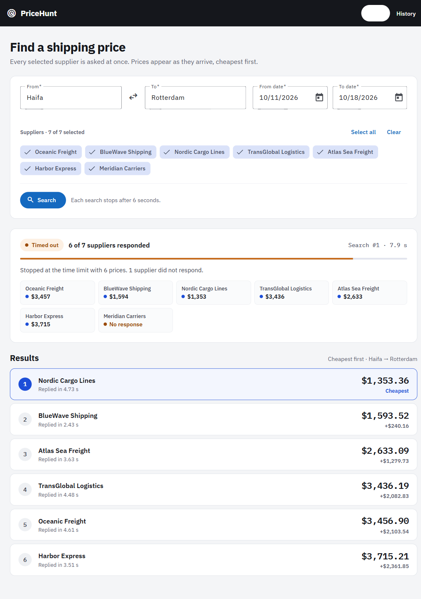
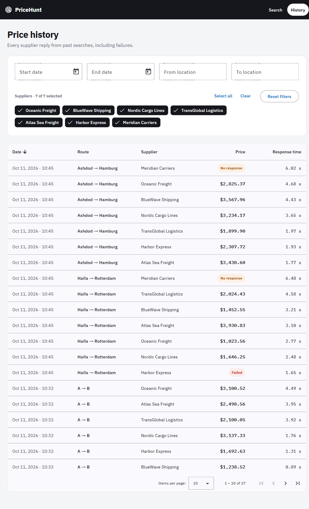

# PriceHunt

Live shipping-price search across seven simulated suppliers, streamed to the
browser as prices arrive, with a persisted and filterable price history.

- **Server:** .NET 10, ASP.NET Core minimal APIs, EF Core 10 + SQLite.
- **Client:** Angular 22, Angular Material, signals + RxJS, Zod.

The step-by-step build plan and every design decision with its rejected
alternatives are in [docs/PLAN.md](docs/PLAN.md).

| Search | History |
|---|---|
|  |  |

## How to run

Prerequisites: the .NET 10 SDK and Node.js 20+. Nothing else to install.

Server, in one terminal:

```
cd server
dotnet run --project src/PriceHunt.Api
```

Client, in another:

```
cd client
npm install
npm start
```

Open `http://localhost:4200`. The dev server proxies `/api` to the API on
`http://localhost:5084`. The SQLite database file is created next to the API
project on first run by applying the migrations.

Tests:

```
cd server && dotnet test        # 211 tests, no database or network setup
cd client && npm test           # 72 tests, Vitest + jsdom
```

## Endpoints

| Endpoint | Purpose |
|---|---|
| `GET /api/suppliers` | The supplier catalog, so the client never hard-codes names. |
| `GET /api/searches/stream?fromLocation&toLocation&fromDate&toDate&suppliers=A&suppliers=B` | Runs a search and streams Server-Sent Events. No `suppliers` means all seven. |
| `GET /api/history?startDate&endDate&suppliers&fromLocation&toLocation&sortBy&sortDirection&page&pageSize` | One page of past responses, filtered, sorted and paged in SQL. |
| `GET /health` | Liveness plus a database check. |
| `GET /openapi/v1.json` | OpenAPI document (Development only). |

Invalid input returns a `400` problem-details body that names every bad
parameter at once.

### The stream

```
event: started   data: {"searchId":"…","supplierCount":7}
event: price     data: {"supplierName":"…","amount":1748.94,"currency":"USD","responseTimeMs":1423}
event: failed    data: {"supplierName":"…","reason":"…","responseTimeMs":3116}
event: ended     data: {"status":"TimedOut","respondedCount":6}
```

`status` is `Completed`, `TimedOut` or `Cancelled`. The client closes the
connection after `ended`, because browsers reconnect to a closed SSE stream
automatically.

## Streaming: why Server-Sent Events

The data flows one way, from server to browser, after the initial request.
SSE is the HTTP standard for exactly that, and it answers the brief's
requirements directly:

- **Stream each result as it arrives.** One long-lived response; each
  supplier result is one flushed event. .NET 10's `TypedResults.ServerSentEvents`
  sets the headers, disables buffering and writes the wire format.
- **Cancellation.** Closing the connection fires the request's cancellation
  token. That token is the one handed to every supplier call, so a closed tab
  or a new search stops the work in progress. No second protocol is needed.
- **Named events.** `started`, `price`, `failed`, `ended` are SSE event
  types, which the browser's built-in `EventSource` dispatches by name.

Rejected: **SignalR** (two-way machinery for a one-way flow, plus a client
library), **chunked JSON lines** (no standard framing, hand-written parser),
**WebSockets** (lowest level, everything by hand).

Trade-off: `EventSource` is GET-only, so the search parameters travel in the
query string. The search is idempotent from the client's point of view and the
parameters are small, so this is acceptable.

## How a search runs

```
Browser ──GET /api/searches/stream──▶ SearchEndpoints
                                        │ parse + validate
                                        ▼
                                     PriceSearch (Application)
                                        │ creates the Search aggregate, saves it
                                        │ runs SupplierFanOut with the configured timeout
                                        ▼
                                     SupplierFanOut
                                        │ one task per supplier ──▶ Channel ──▶ single reader
                                        ▼
                                     each outcome: record on aggregate → save → yield event
                                        ▼
                                     end: Completed / TimedOut / Cancelled → save
```

- Each supplier runs as its own task writing into a `System.Threading.Channels`
  channel. The single reader yields outcomes in arrival order.
- The timeout (`Search:Timeout` in `appsettings.json`, six seconds) and the
  request's cancellation are linked into one token that every supplier
  receives. When it fires, the channel closes, so even a supplier that ignores
  cancellation cannot keep the stream open, and a late result is dropped.
- A supplier that throws becomes a `failed` event for that supplier only.
- The final status comes from two facts: did the caller's token fire
  (Cancelled), and did every supplier answer (Completed, otherwise TimedOut).
  The final save ignores the caller's token, so a cancelled search is always
  recorded as such. This was verified by disconnecting a real client and
  reading the database.
- Every outcome is saved before it is sent, so what the client sees is already
  on disk.

## The client

Two screens, each a **container** that owns state and talks to the API, built
from **presentational** components that only take inputs and emit outputs.

**Search.** `SearchPage` holds one state signal and a stream of commands piped
through RxJS `switchMap`. Subscribing to a new search unsubscribes the previous
one, which closes its `EventSource`, which the server records as Cancelled.
That one operator is the brief's "a new search cancels the previous one". The
state logic (begin, apply event, cancel, rank prices, progress) is a set of
pure functions with their own tests. The results list is rendered with
`@for … track supplierName`, so when a cheaper price arrives Angular moves the
existing rows instead of recreating them: no flicker.

**History.** `HistoryPage` combines three signals, filters, sort and paging,
into one query; each change becomes a request through `switchMap`, so a stale
response can never overwrite a newer one. The table is Angular Material's with
sort headers and a paginator, but it only reports intent: sorting and paging
happen on the server.

**At the boundary.** Every SSE message and every history response is
validated with a Zod schema, and the TypeScript types are inferred from the
schemas. A server message that does not match the contract becomes a visible
error instead of a silently wrong object. There are no `as` casts in the
client.

**Styling.** The screens follow a mockup through Angular Material's theme and
override mixins: IBM Plex type, a dark toolbar, white cards and dark selected
chips.

## Database

SQLite through EF Core, schema created by migrations at startup. Migrations
rather than `EnsureCreated()` because they can evolve the schema later; a test
fails if the model changes without a new migration.

```
Searches
  Id                  GUID (v7, time-ordered)   PK
  FromLocation, ToLocation            Route value object (complex type)
  FromDate, ToDate                    DateRange value object (complex type)
  RequestedSuppliers  JSON array of names
  StartedAt, EndedAt  UTC            indexed on StartedAt
  Status              Running | Completed | TimedOut | Cancelled

SupplierResponses                     one row per supplier per search
  Id                  PK autoincrement
  SearchId            FK → Searches, cascade      indexed
  SupplierName                                    indexed with RecordedAt
  Outcome             Priced | Failed | NoResponse
  PriceMinorUnits, PriceCurrency      Money value object, null unless Priced
  FailureReason       null unless Failed
  ResponseTimeMs
  RecordedAt          UTC
```

Why these shapes:

- **Money in integer cents, durations in milliseconds.** SQLite stores
  `decimal` as text, which does not sort numerically, and `double` is the wrong
  type for money. Integers sort correctly in SQL and lose nothing.
- **UTC `DateTime` columns, `DateTimeOffset` in the domain.** The SQLite
  provider cannot translate `DateTimeOffset` comparisons; a value converter
  bridges the two so the domain does not bend to the database.
- **Requested suppliers as JSON.** The list belongs to the search and is never
  queried alone; a join table would add a join for no query we have.
- **A `NoResponse` row for suppliers that never answered.** The brief asks for
  failures to be recorded, and "never answered within the limit" is the most
  useful failure to see in history.

## Server architecture

Clean Architecture in four projects; dependencies point inward and are
enforced by project references.

| Project | Contains | Depends on |
|---|---|---|
| `PriceHunt.Domain` | `Search` aggregate, `SupplierResponse`, value objects `Route`, `DateRange`, `Money` | nothing |
| `PriceHunt.Application` | `PriceSearch` use case, `SupplierFanOut`, the ports `ISupplier`, `ISupplierCatalog`, `ISearchRepository`, `IHistoryReader` | Domain |
| `PriceHunt.Infrastructure` | `SimulatedSupplier` (one class, seven profiles), EF Core context, migrations, repository, history reader | Application |
| `PriceHunt.Api` | Endpoints, query parsers, SSE mapping, DI composition, settings | Application, Infrastructure |

Points worth knowing:

- **The `Search` aggregate owns the rules.** A supplier must have been
  requested, may answer once, nothing is recorded after the end, and ending
  the search writes a `NoResponse` for every supplier that never answered.
- **Time is injected.** All delays and the timeout go through `TimeProvider`,
  so the fan-out and the simulated suppliers are tested with a fake clock in
  milliseconds, with no sleeps.
- **Suppliers are a port.** The simulator is one adapter; an HTTP client for a
  real carrier would be another, registered the same way.
- **Configuration stays in the host.** The timeout is `Search:Timeout` in
  `appsettings.json`; the application layer receives a plain options object and
  knows nothing about configuration keys.
- **Validation at the edge, invariants in the domain.** The parsers produce
  friendly messages; the value objects still reject bad data if bypassed.

## Testing

- **Domain:** value-object and aggregate invariants.
- **Application:** fan-out and use case with scripted suppliers and
  `FakeTimeProvider`: arrival order, failure isolation, timeout, cancellation
  propagation, late results, early consumer exit.
- **Infrastructure:** simulated supplier with scripted random draws; repository
  and history reader against in-memory SQLite created by the real migrations;
  a model-snapshot check for the migrations.
- **Api:** parsers; in-process integration tests that read the real SSE stream
  with the BCL `SseParser`, including a client disconnect that must end as
  Cancelled, not TimedOut.
- **Client:** the API clients against a fake `EventSource` and Angular's HTTP
  testing controller; the pure search-state functions; the page containers
  with fake clients (a second search closes the first stream; filter and sort
  changes return to page one); the presentational components.

## What I would do differently with more time

- Run migrations as a deployment step rather than at startup, so several
  instances cannot race on the schema.
- Add authentication, rate limiting and HTTPS redirection, none of which the
  brief asks for.
- Add a summary endpoint (search count, reply count, failures, lowest price) so
  the history screen can show the stat tiles from the mockup over the whole
  filtered set rather than one page.
- Expose the search time limit to the client instead of repeating "6 seconds"
  in the copy.
- Replace `Random.Shared` in the simulator with a seedable source per run for
  reproducible demos.

## AI usage

I used Claude Code as a pair programmer for the whole project, with a
deliberate workflow: I made every design decision, the tool produced the
first draft of each step, and I reviewed and corrected before committing.

- **Design.** I asked for comparison tables with pros, cons and references
  for the streaming transport (SSE vs SignalR vs chunked JSON vs
  WebSockets), the solution structure (Clean, Onion, Hexagonal, Vertical
  Slice, N-tier) and the fan-in mechanism (Channels, WhenAny, WhenEach,
  Rx.NET, Dataflow). I chose SSE, Clean Architecture and Channels and can
  defend each choice against its alternatives.
- **Implementation.** Each of the 17 steps was generated test-first, reviewed
  by me, and committed separately so the history shows the order of
  construction.
- **Corrections I drove.** Replacing a hand-driven async enumerator with
  `await foreach` plus `finally` for cancellation; renaming "quote" to
  "price" to match the brief's vocabulary; moving the search timeout from a
  constant into `appsettings.json` with validation on startup; dropping a
  planned `SearchRecorder` class as needless indirection; for the client,
  requiring popular libraries over custom code, a strict container versus
  presentational split, and no `as` casts, which led to Zod validation at
  the boundary.
- **Verification.** The tool ran the test suites, generated the EF Core
  migration, performed the smoke tests, including a real client disconnect
  to confirm the search is recorded as Cancelled, and drove both screens in
  a real browser against the running API.
- **Documentation.** The plan and this README were drafted with the tool
  and edited by me.

The git history shows the work in the order it was built, one step per commit.
